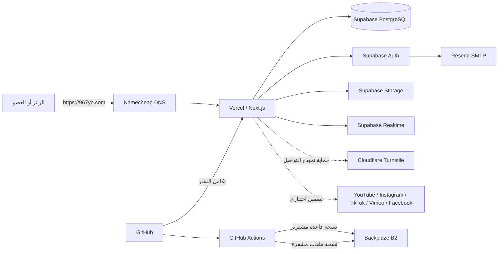

# الدليل الشامل لموقع مبادرة 967

> **المرجع الأول لأي شخص سيعمل على الموقع.** يشرح هذا الملف كيف يعمل المشروع، وما الخدمات الخارجية المرتبطة به، وكيف تُدار البيانات والصلاحيات والنشر والنسخ الاحتياطية، وما طريقة العمل المفضلة في المشروع.
>
> آخر مراجعة للمستودع: **6 نوفمبر 2026**. عنوان الموقع: **[967ye.com](https://967ye.com)**. مستودع الشفرة: **[AihamAnter/967-initiative](https://github.com/AihamAnter/967-initiative)**.

## فهرس سريع

- [الصورة الكاملة والخدمات](#2-الصورة-الكاملة-في-دقيقة-واحدة)
- [الخدمات والمواقع المرتبطة](#4-الخدمات-والمواقع-المرتبطة-بالموقع)
- [خريطة وظائف الموقع](#6-خريطة-وظائف-الموقع)
- [خريطة المستودع](#8-خريطة-المستودع)
- [متغيرات البيئة والأسرار](#9-متغيرات-البيئة-والأسرار)
- [التشغيل المحلي](#10-التشغيل-المحلي)
- [Supabase والترحيلات](#11-supabase-قاعدة-البيانات-والمصادقة-والتخزين)
- [GitHub وCI والنشر](#13-github-وci-والنشر)
- [طريقة العمل المفضلة](#16-طريقة-العمل-المفضلة-ومفضلات-المشروع)
- [الاختبارات](#17-التحقق-والاختبارات)
- [تشخيص الأعطال](#19-أعطال-شائعة-وكيف-تبدأ-تشخيصها)
- [قائمة استلام المشروع](#20-قائمة-استلام-المشروع-لشخص-جديد)

## 1. اقرأ هذا أولًا

الموقع ليس صفحات ثابتة فقط. هو تطبيق **Next.js** عربي وRTL يجمع بين المحتوى العام، الأدلة، الإحصاءات، الخريطة، المناظرات، الحسابات، الرسائل، مدرسة 967، الألعاب، ولوحة تحرير متكاملة. يعتمد التشغيل المنشور على عدة خدمات خارجية، أهمها Vercel وSupabase.

قبل أن تبدأ أي تعديل:

1. اقرأ هذا الملف كاملًا مرة واحدة.
2. نفّذ `git status --short` ولا تحذف أو تستبدل ملفات لا تخص مهمتك.
3. حدّد هل التعديل يخص الشفرة فقط، أم يحتاج قاعدة بيانات أو إعداد خدمة خارجية.
4. لا تطبق SQL، ولا تشغّل سكربتات إدخال البيانات، ولا تغيّر إعدادات الإنتاج دون موافقة صريحة ونسخة احتياطية.
5. نفّذ التغيير في بيئة محلية أو اختبارية معزولة، ثم اختبره قبل الدمج أو النشر.
6. اعتبر الملفات المؤرخة داخل `docs/` تقارير للحالة وقت كتابتها؛ لا تفترض أن تعليماتها القديمة ما زالت صالحة للإنتاج.

### ترتيب مصادر الحقيقة

عند وجود تعارض بين الوثائق:

1. **بالنسبة للشفرة:** المصدر الحالي داخل `app/` و`components/` و`lib/` و`package.json`.
2. **بالنسبة لقاعدة البيانات:** الملفات النشطة داخل `supabase/migrations/` ثم الحالة الفعلية لمشروع Supabase.
3. **بالنسبة للاستضافة وDNS والبريد والنسخ:** إعدادات لوحات Vercel وNamecheap وSupabase وResend وGitHub وBackblaze الفعلية.
4. هذا الدليل هو خريطة العمل الموحدة، ثم تأتي التقارير المتخصصة والمؤرخة داخل `docs/` للتفاصيل والأدلة.

لا يعني وجود ملف أو Migration في GitHub أنه مطبق على الإنتاج، ولا يعني نجاح نشر Vercel أن قاعدة البيانات أو البريد أو النسخ الاحتياطية تعمل كما ينبغي.

## 2. الصورة الكاملة في دقيقة واحدة



المسار المعتاد هو:

1. يفتح المستخدم `967ye.com`.
2. Namecheap يدير DNS ويوجه النطاق إلى Vercel.
3. Vercel يشغّل تطبيق Next.js ويقدم الصفحات وواجهات API.
4. التطبيق يقرأ ويكتب البيانات عبر Supabase، ويستخدم Supabase Auth للحسابات وSupabase Storage للملفات.
5. رسائل تأكيد البريد واستعادة كلمة المرور تمر من Supabase Auth عبر Resend SMTP.
6. GitHub هو مصدر الشفرة، وتكامل GitHub مع Vercel ينشر التغييرات وفق إعدادات المشروع الخارجية.
7. GitHub Actions يشغّل التحقق وبعض فحوص المتصفح والنسخ الاحتياطية المشفرة إلى Backblaze B2.

## 3. التقنيات الأساسية

| الطبقة | التقنية الحالية | مكانها في المشروع |
| --- | --- | --- |
| إطار التطبيق | Next.js 15، App Router | `app/` |
| الواجهة | React 19، JavaScript/JSX، CSS | `components/` و`app/*.css` |
| اللغة والتصميم | العربية أولًا، RTL، هاتف وحاسوب، وضع فاتح وداكن | `app/layout.jsx` وملفات CSS |
| قاعدة البيانات | Supabase PostgreSQL | `supabase/migrations/` و`lib/*Repository.js` |
| الحسابات | Supabase Auth | `app/login` و`app/register` و`app/auth` و`lib/supabase.js` |
| تخزين الملفات | Supabase Storage | الصور والأغلفة وPDF والصور الشخصية |
| الرسوم | Recharts | صفحات الإحصاءات والترتيب |
| قراءة PDF | PDF.js | قارئ أعداد المجلة |
| الأيقونات | Lucide React | مكونات الواجهة |
| الاختبارات | Node test runner، PGlite، وسكربتات متصفح معزولة | `tests/` و`scripts/` |
| النشر | Vercel | إعداد خارجي مرتبط بـGitHub |
| الأتمتة | GitHub Actions | `.github/workflows/` |

إصدارات Node المقبولة حسب `package.json`: **22.13 أو أحدث ضمن 22.x، أو 24 فأحدث**. استخدم ملف `package-lock.json` و`npm ci` للحصول على تثبيت قابل للتكرار.

## 4. الخدمات والمواقع المرتبطة بالموقع

توزيع الخدمات التالي مطابق للبنية التي أكدها مالك المشروع والموجودة في وثيقة المعمارية وملفات التشغيل. إعدادات الحسابات الخارجية نفسها ليست مخزنة في Git؛ يجب إعادة التحقق من لوحاتها عند الاستلام أو قبل تغيير البنية.

### 4.1 خدمات ضرورية لتشغيل الإنتاج

| الخدمة | دورها | ماذا يحدث عند تعطلها؟ | مكان الإعداد |
| --- | --- | --- | --- |
| **Namecheap** | تسجيل النطاق `967ye.com` وإدارة DNS | لا يصل النطاق المخصص إلى الموقع، مع احتمال بقاء رابط Vercel المباشر | حساب Namecheap وDNS |
| **Vercel** | استضافة تطبيق Next.js، الصفحات، Server Components وواجهات API | يتوقف الموقع المنشور أو تتعطل الطلبات الخادمية | مشروع Vercel المرتبط بالمستودع |
| **GitHub** | مستودع الشفرة وسجل التغييرات ونقطة بدء النشر | لا تتوقف النسخة المنشورة فورًا، لكن يتعطل التطوير والنشر من المصدر | `AihamAnter/967-initiative` |
| **Supabase PostgreSQL** | المحتوى، الإحصاءات، الأدلة، الحسابات المساندة، المناظرات، المهام، المدرسة، الألعاب والرسائل | تتعطل البيانات الحية والكتابة؛ بعض الأقسام فقط قد تعرض بيانات محلية احتياطية | مشروع Supabase والترحيلات |
| **Supabase Auth** | التسجيل والدخول والجلسات وتأكيد البريد والاستعادة | تتعطل الحسابات والإدارة والميزات الشخصية | Supabase Authentication |
| **Supabase Storage** | أغلفة المجلة وملفات PDF والصور والصور الشخصية وملفات المحتوى | قد تظهر صور أو ملفات مفقودة، وتتوقف عمليات الرفع | Supabase Storage |
| **Supabase Realtime** | تحديث نتائج المناظرات والرسائل الخاصة عند تغير البيانات | تبقى آليات إعادة القراءة الدورية لبعض الوظائف، لكن التحديث الفوري يتأخر | إعداد Realtime وسياسات الجداول |
| **Resend SMTP** | إرسال رسائل Supabase Auth من `no-reply@967ye.com` | يبقى التصفح العام، لكن قد يفشل تأكيد البريد والاستعادة | إعداد SMTP داخل Supabase وحساب Resend |

### 4.2 خدمات تشغيلية مساندة

| الخدمة | الاستخدام الحالي | الملاحظة المهمة |
| --- | --- | --- |
| **GitHub Actions** | اختبارات PR، بعض فحوص المتصفح، نسخ قاعدة البيانات وStorage | لا تعتمد على نجاح Vercel وحده كبديل عن هذه الفحوص |
| **Backblaze B2** | حفظ النسخ اليومية المشفرة من PostgreSQL وSupabase Storage | الاستعادة الكاملة تحتاج اختبارًا دوريًا؛ وجود الملف وحده لا يثبت قابلية الاستعادة |
| **Cloudflare Turnstile** | حماية اختيارية وموصى بها لنموذج التواصل من الرسائل الآلية | يحتاج مفتاح موقع ومفتاحًا سريًا مطابقين للنطاق؛ ليس شرطًا لعرض الصفحات |

### 4.3 خدمات ومواقع مرتبطة بالمحتوى وليست أساس تشغيل الموقع كله

- **YouTube وYouTube No-Cookie وInstagram وTikTok وVimeo وFacebook:** تضمين الأعمال الإعلامية عندما يحتوي السجل على رابط عام مدعوم. إذا منع المزود التضمين يبقى رابط المصدر الأصلي.
- **World Bank API:** تحديث لقطات «ترتيب اليمن» عبر `npm run data:rankings`. الموقع المنشور يقرأ الملفات المحلية الناتجة؛ لا يحتاج الاتصال بالـAPI مع كل زيارة.
- **Google Maps وWhatsApp والشبكات الاجتماعية:** روابط خروج أو تواصل داخل بعض الأدلة والملفات، وليست طبقة بيانات أساسية.
- **المواقع الحكومية والدولية والمراجع الأكاديمية وWikimedia وغيرها:** مصادر تحريرية وإسناد للمعلومات والصور، وليست خدمات تشغيلية موحدة.

### 4.4 ما لا يعتمد على خدمة تتبع خارجية

- تحليلات الاستخدام الحالية داخلية ومجمعة في Supabase؛ لا يوجد Google Analytics في مسار التشغيل الموثق.
- الخطوط الأساسية مستضافة داخل `public/fonts/`.
- قارئ PDF جزء من التطبيق عبر `pdfjs-dist`.
- بيانات الخريطة والكتالوجات واللقطات المحلية موجودة داخل `data/` و`public/` بحسب القسم.

## 5. كيف يعمل الطلب داخل التطبيق

### 5.1 زيارة صفحة عامة

1. يستقبل Next.js المسار داخل `app/`.
2. يقرأ Server Component البيانات عبر وحدات `lib/`؛ نقطة التجميع الرئيسية لعدة أقسام هي `lib/data.js`.
3. يستخدم الخادم `serverDb()` من `lib/supabase-server.js` عند توفر `NEXT_PUBLIC_SUPABASE_URL` و`SUPABASE_SERVICE_ROLE_KEY`.
4. تُطبق شروط النشر والظهور، مثل `is_published` وإعدادات إظهار الأقسام في `site_settings`.
5. يُنشأ HTML عربي مع Metadata وCanonical وJSON-LD، ثم يضيف العميل التفاعلات اللازمة فقط.

### 5.2 مستخدم مسجل

1. ينشئ المتصفح عميل Supabase بالمفتاح العام من `lib/supabase.js`.
2. Supabase Auth يحفظ الجلسة ويجددها في المتصفح.
3. عند استدعاء API خاص، يرسل المتصفح Bearer token.
4. يتحقق الخادم من المستخدم عبر `auth.getUser` ولا يثق بمعرف أو دور مرسل من الواجهة.
5. تحمي RLS ملكية المحفوظات والمجموعات والإشعارات والمشاركات وسائر البيانات الشخصية.
6. تستخدم نتائج المناظرات والرسائل الخاصة Supabase Realtime للتحديث السريع، مع إعادة قراءة دورية حتى لا يعتمد السلوك كليًا على WebSocket.

### 5.3 محرر أو إدارة

1. الحساب العادي لا يصبح محررًا تلقائيًا.
2. يجب أن يوجد المستخدم في جدول `editors` بدور `admin` أو `management`.
3. تتحقق طلبات الإدارة في الخادم من الأصل والجلسة وتأكيد البريد والحظر والدور.
4. دور `management` يملك إجراءات إضافية مثل إدارة الأدوار وبعض قرارات الإشراف الحساسة.
5. لا يجوز بناء قرار صلاحية على `user_metadata` أو على قيمة دور يرسلها المتصفح.

### 5.4 رفع ملف أو عرض وسائط

- يرفع المحرر الصور وملفات المجلة إلى Supabase Storage وفق سياسات القسم والحجم والنوع.
- توجد ثلاث حاويات مشمولة في نسخة Storage الحالية: `media` و`967-account-avatars` و`figure-profiles`.
- الأعمال الإعلامية لا تعيد استضافة فيديوهات المنصات عادةً؛ تحفظ الرابط وتبني تضمينًا مسموحًا عند الطلب.
- الروابط غير المدعومة أو المحجوبة لا تكسر صفحة العمل؛ يظهر رابط فتح المصدر.

### 5.5 النسخ الاحتياطي

- GitHub Actions ينفذ `pg_dump` بصيغة PostgreSQL 17، ويتحقق من وجود `auth.users`، ويحسب checksum، ثم يشفّر الأرشيف بـGPG/AES-256 ويرفعه إلى B2.
- Workflow مستقل ينزل الحاويات الثلاث، يقارن عدد الملفات، يشفّرها ويرفعها إلى B2.
- بعد الرفع يُنزّل الأرشيف مرة أخرى ويُقارن ويفك تشفيره للتحقق الأساسي.
- Workflow الاستعادة اليدوي يعيد **عينة محددة** إلى PostgreSQL مؤقت ومعزول؛ ليس تمرين استعادة كاملًا لمنصة Supabase أو Storage.

## 6. خريطة وظائف الموقع

### 6.1 المحتوى العام

| المجال | أهم المسارات | المصدر الأساسي |
| --- | --- | --- |
| الرئيسية والتنقل | `/` | إعدادات الموقع، أحدث محتوى، وكتالوج التنقل |
| الأعمال الإعلامية | `/works` و`/works/[slug]` | جدول `works` وروابط مزودي الفيديو |
| مجلة 967 | `/magazine` و`/magazine/[slug]` | `issues` وملفات PDF في Storage |
| مناظرات 967 | `/debates` و`/debates/[slug]` | جداول ودوال المناظرات في Supabase |
| اليمن بالأرقام | `/yemen-in-numbers` ومسارات المجالات والمؤشرات | `stat_*` ومصادرها وقيمها المنشورة |
| ترتيب اليمن | `/yemen-ranking` | كتالوج/لقطات داخل `data/rankings` مع تحرير اختياري في Supabase |
| خريطة اليمن | `/yemen-map` ومسارات المحافظات والشخصيات | بيانات الخريطة وملفات Supabase التحريرية |
| شخصيات يمنية | `/yemeni-figures` و`/[slug]` | Supabase مع كتالوج محلي في بعض أوضاع المعاينة |
| تاريخ اليمن | `/yemen-history` و`/[slug]` | محتوى التاريخ والمقارنات |
| الأدلة | `/yemeni-products` و`/professionals` و`/universities` و`/medical-centers` | جداول الأدلة ومصادرها وتواريخ التحقق |
| البحث | `/search` | إسقاط آمن من المحتوى العام المنشور فقط |
| المساهمة والتواصل | `/contribute` | API التواصل والجداول الداخلية وTurnstile عند تفعيله |
| صفحات المبادرة | `/about` و`/help` و`/privacy` و`/terms` و`/privacy-requests` و`/pages/[slug]` | افتراضيات محلية أو صفحات محررة في `site_settings` |

يمكن للمحرر إخفاء أقسام عامة من إعدادات الظهور. تعريف الأقسام الحالي في `lib/pageVisibility.js`. الإخفاء يزيل الروابط ويمنع عرض المسارات العامة، لكنه لا يحذف البيانات.

### 6.2 مدرسة 967

- نقطة البداية: `/school`.
- الأقسام الحالية: الكتابة والأدب، الفلك والطبيعة، المنطق والتفكير، والسياسة والاقتصاد/التربية المدنية.
- التصفح العام متاح حسب إعداد الظهور، بينما حفظ التقدم والنقاط وبعض الوظائف يحتاج حسابًا.
- استوديو المحتوى في `/school/studio` له تحقق وصلاحيات منفصلة.
- الواجهة الحالية تصف 15 مسارًا و180 محطة؛ راجع `lib/school*.js` وMigrations المدرسة قبل تغيير العدد أو منطق فتح المراحل.

### 6.3 ألعاب 967

- نقطة البداية: `/games`.
- الألعاب التسع الحالية: الاختبار، خمن المكان، ترتيب التاريخ، الخريطة، من أنا، أيهما أكبر، ربط المعلومة، الكلمة اليمنية، وما هذا الشيء.
- توجد جولة حرة، تحديات يومية، نتائج موثقة على الخادم، لوحة متصدرين، أصدقاء، مهمات أسبوعية وإنجازات.
- **التحدي اليومي الرسمي يُسحب في الخادم:** `POST /api/games/daily` يختار الجولة ببذرة سرية ويعيد المهام عبر `friendPublicTask` بلا إجابات، و`/api/games/daily/round` يعيد المهمة كاملة بعد اعتماد الإجابة فقط. لا تبنِ جولة رسمية في المتصفح ولا ترسل `correct` أو `regionId` أو `answer` قبل الإجابة. أسئلة اختبار اليوم تُستبعد من بنك التدريب ومن تحديات الأصدقاء. الاختبار `tests/daily-hidden-answers.test.mjs` يحرس ذلك للألعاب التسع.
- لا تثق بنتيجة يرسلها العميل عند حفظ نتيجة رسمية؛ منطق التحقق في `lib/game*.js` وواجهات `app/api/games/`.

### 6.4 الحساب والتفاعل

| الوظيفة | المسار |
| --- | --- |
| التسجيل والدخول والاستعادة | `/register` و`/login` و`/forgot-password` و`/update-password` و`/auth/callback` |
| مساحة الحساب | `/account` و`/account/activity` |
| القراءة لاحقًا | `/read-later`، مع حفظ محلي وسحابي عند التسجيل |
| مركز الإشعارات | `/notifications` |
| الرسائل الخاصة | `/messages` |
| ملف العضو | `/members/[id]` |
| اقتراح المناظرات والتعليقات والأسئلة والتصويت | داخل مسارات المناظرات حسب الجلسة والسياسات |

لا تُعرض رسائل المستخدمين أو محفوظاتهم أو أصواتهم الفردية أو بيانات Auth في البحث العام. الحسابات والصفحات الخاصة مضبوطة `noindex`.

### 6.5 لوحة التحرير

المسار الرئيسي `/admin` يحتوي حاليًا على تبويبات:

- المجلة والأعمال.
- الشركات والمنتجات والمهنيين والجامعات والمراكز الطبية.
- الشخصيات والتاريخ والألعاب.
- الإحصاءات وترتيب اليمن والخريطة.
- صفحات الموقع والإعدادات والرسائل.
- إدارة الأدمن لدور `management` فقط.

مسارات إدارة متخصصة:

- `/admin/tasks`: مركز مهام الفريق والتعليقات والتقويم وKanban.
- `/admin/debates`: إنشاء المناظرات ونشرها والإشراف عليها.
- `/admin/contributions`: سجل المساهمات التحريرية.
- `/admin/analytics`: تحليلات استخدام مجمعة تحترم الخصوصية.
- `/admin/users`: إدارة المستخدمين حسب الدور.
- `/admin/message-reports` و`/admin/member-reports`: مراجعة البلاغات.

يوجد أيضًا **تحرير مباشر** من الصفحات العامة للحسابات المخولة. هو واجهة لنظام الإدارة نفسه، وليس قاعدة بيانات أو نظام صلاحيات منفصلًا.

## 7. مصادر البيانات وأنماط التشغيل

### 7.1 بيانات Supabase الحية

هي المصدر المعتاد للمحتوى المحرر، الحسابات، التفاعل، المهام، المدرسة والألعاب. القراءة العامة يجب أن تعيد السجلات المنشورة فقط، والكتابة تمر عبر RLS أو API/RPC موثوق.

### 7.2 بيانات محلية داخل المستودع

- `data/`: كتالوجات ولقطات وبيانات بحث وترتيب وخريطة بحسب القسم.
- `public/`: صور وخطوط وملف PDF تجريبي وأصول ثابتة.
- `lib/config.js`: افتراضيات عامة وبعض المحتوى التجريبي المعلّم بوضوح.
- بعض الأقسام تستخدم بيانات محلية عندما لا تكون قاعدة البيانات متاحة؛ أقسام أخرى تعرض حالة فارغة أو خطأ. لا تفترض أن الموقع كامل الوظائف دون Supabase.

### 7.3 وضع العرض أو الاختبار المحلي

يوجد `LOCAL_CONTENT_FALLBACK=1` وبعض متغيرات المعاينة مثل `NEXT_VALIDATION_BUILD` و`NEXT_TASK_PREVIEW` و`NEXT_PHASE4_PREVIEW`. هذه أدوات تحقق محلية، وليست إعدادات إنتاج دائمة. لا تضفها إلى Vercel إلا إذا كان هناك سبب موثق ومراجَع.

### 7.4 بيانات Demo

العدد التجريبي وبعض الكتالوجات المحلية يجب أن تبقى موسومة بأنها تجريبية أو توضيحية. لا تعرض المثال كأنه منشور رسمي، ولا تنشئ بيانات مصطنعة لتبدو المنصة ممتلئة.

## 8. خريطة المستودع

```text
967-initiative/
├─ app/                    صفحات Next.js وواجهات API وملفات التخطيط
├─ components/             مكونات الواجهة والإدارة والحساب والمدرسة والألعاب
├─ lib/                    منطق الأعمال والأمان والمستودعات والبيانات
├─ data/                   بيانات ولقطات وكتالوجات محلية
├─ public/                 الصور والخطوط والملفات الثابتة
├─ supabase/
│  ├─ migrations/          الترحيلات النشطة المرتبة زمنيًا
│  └─ archive/             ترحيلات تاريخية مرجعية؛ ليست للتطبيق التلقائي
├─ tests/                  اختبارات Node وPGlite
├─ scripts/                فحوص واستيراد وتحديث بيانات وfixtures
├─ docs/                   أدلة الأقسام وتقارير التنفيذ والتدقيق والأدلة
├─ .github/workflows/      CI وفحوص المتصفح والنسخ والاستعادة
├─ .env.example            أسماء متغيرات التطبيق المطلوبة دون أسرار
├─ package.json            الأوامر والاعتماديات وإصدار Node
└─ PROJECT_GUIDE_AR.md     هذا الدليل
```

قبل تعديل وظيفة، ابدأ من مسار الصفحة في `app/`، ثم اتبع imports إلى `components/` و`lib/`، ثم ابحث عن الجدول أو Migration والاختبارات المرتبطة بها باستخدام `rg`.

## 9. متغيرات البيئة والأسرار

### 9.1 متغيرات التطبيق

انسخ `.env.example` إلى `.env.local` محليًا، ولا ترفع `.env.local` إلى Git.

| المتغير | عام أم سري؟ | الاستخدام |
| --- | --- | --- |
| `NEXT_PUBLIC_SUPABASE_URL` | عام | عنوان مشروع Supabase |
| `NEXT_PUBLIC_SUPABASE_ANON_KEY` | عام، لكن يعتمد أمانه على RLS | عميل المتصفح وطلبات المستخدم |
| `SUPABASE_SERVICE_ROLE_KEY` | **سري وخادمي فقط** | APIs وقراءات/كتابات الخادم ذات الامتياز |
| `NEXT_PUBLIC_SITE_URL` | عام | Canonical والتحقق من النطاق والروابط؛ في الإنتاج `https://967ye.com` |
| `NEXT_PUBLIC_TURNSTILE_SITE_KEY` | عام | عنصر Turnstile في نموذج التواصل |
| `TURNSTILE_SECRET_KEY` | **سري** | تحقق Turnstile في الخادم |
| `CONTACT_RATE_LIMIT_SECRET` | **سري اختياري** | HMAC لحدود طلبات التواصل؛ لا يبدأ بـ`NEXT_PUBLIC_` |
| `GAME_DAILY_SECRET` | **سري اختياري** | بذرة اختيار أسئلة التحدي اليومي في الخادم (`lib/dailyOfficialSeed.js`). إن غاب استُخدم `SUPABASE_SERVICE_ROLE_KEY`. تغييره يغيّر أسئلة اليوم، فلا يُغيَّر أثناء يوم تحدٍّ جارٍ |

أي متغير يبدأ بـ`NEXT_PUBLIC_` يصل إلى المتصفح. لا تضع فيه مفتاح `service_role` أو SMTP أو B2 أو أي سر.

### 9.2 أسرار GitHub Actions للنسخ الاحتياطية

يجب أن تبقى في **Repository secrets** ولا تكتب في الملفات أو السجلات:

- `SUPABASE_DB_URL`
- `SUPABASE_S3_ACCESS_KEY_ID`
- `SUPABASE_S3_SECRET_ACCESS_KEY`
- `BACKUP_ENCRYPTION_PASSPHRASE`
- `B2_KEY_ID`
- `B2_APPLICATION_KEY`

الحاوية الحالية في Workflow هي `967ye-supabase-backups-2026` ونقطة B2 في منطقة `eu-central-003`. تغييرها يتطلب تحديث Workflow واختبار رفع وتنزيل واستعادة.

### 9.3 إعدادات لا توجد في Git

- قيم DNS الفعلية في Namecheap.
- ربط النطاق والمستودع ومتغيرات البيئة في Vercel.
- مفاتيح Supabase وSMTP وAuth redirect URLs وإعدادات البريد.
- مفاتيح B2 وسياسة دورة حياة الحاوية.
- حالة نجاح آخر نشر وآخر Backup وآخر Restore test.

لذلك يجب على المستلم الجديد طلب صلاحية قراءة لوحات الخدمات المناسبة، لا مجرد صلاحية GitHub.

## 10. التشغيل المحلي

### 10.1 التثبيت السريع على PowerShell

```powershell
npm ci
Copy-Item .env.example .env.local
npm run dev
```

ثم افتح `http://localhost:3000`.

املأ `.env.local` فقط إذا احتجت الاتصال بمشروع Supabase مصرح به. من دون الإعدادات قد تعمل أجزاء تعتمد على ملفات محلية، لكن الدخول والإدارة والكتابة والبيانات الحية لن تكون مكتملة.

إذا منعت سياسة PowerShell تشغيل `npm.ps1`، استخدم `npm.cmd` بدل `npm`.

### 10.2 بناء إنتاج محلي

```powershell
npm test
npm run lint
npm run build
npm start
```

لا تشغّل `next dev` و`next build` على مجلد `.next` نفسه بالتوازي. إذا احتجت بناء تحقق منفصل أثناء بقاء التطوير مفتوحًا:

```powershell
$env:NEXT_VALIDATION_BUILD='1'
npm run build
```

### 10.3 تشغيل محلي آمن

- استخدم مشروع Supabase اختباريًا أو fixture محليًا للكتابة والتجارب.
- لا تستخدم حسابات المستخدمين أو بيانات الإنتاج لاختبار CRUD.
- لا ترسل نموذج تواصل حقيقي ولا بريدًا ولا إشعارًا خارجيًا إلا إذا كانت المهمة تطلب اختبار التكامل صراحةً.
- أوقف خوادم fixtures بعد انتهاء الاختبار.

## 11. Supabase: قاعدة البيانات والمصادقة والتخزين

### 11.1 الترحيلات

- الملفات داخل `supabase/migrations/` هي المسار النشط الحالي، بدءًا من Baseline ثم الترحيلات اللاحقة.
- الملفات داخل `supabase/archive/legacy-migrations/` تاريخية للاختبارات والمرجعية؛ **لا تُطبّق على الإنتاج** لمجرد أن وثيقة قديمة ذكرتها.
- ملفات SQL في جذر `supabase/` قد تكون bootstrap قديمًا، أو إعداد قسم، أو seed، أو اقتراحًا؛ لا تشغّلها جماعيًا ولا تعتبرها أحدث من Migrations.
- التطبيق لا يطبق SQL تلقائيًا عند التشغيل أو النشر.

عند الحاجة إلى تغيير مخطط قاعدة البيانات:

1. افحص الحالة الحالية في Supabase وسجل Migrations.
2. خذ نسخة احتياطية وتأكد من نجاح آخر Backup.
3. أنشئ Migration جديدة بالطريقة المعتمدة في Supabase CLI بعد مراجعة `--help`؛ لا تخترع اسم إصدار يدويًا.
4. جرّبها أولًا على قاعدة معزولة مع بيانات اختبار غير حساسة.
5. راجع RLS وGRANT وRPC وStorage policies والفهارس والتراجع الممكن.
6. شغّل اختبارات PGlite/Node المناسبة وتحقق باستعلامات فعلية.
7. لا تطبقها على الإنتاج قبل مراجعة وموافقة صريحة.
8. بعد التطبيق، اختبر مستخدمًا مجهولًا وعضوًا ومحررًا وManagement بحسب النطاق، ثم وثق النتيجة.

### 11.2 قواعد الأمان الأساسية

- فعّل RLS على كل جدول مكشوف عبر Data API، واكتب سياسة تناسب الملكية الفعلية.
- `authenticated` يعني أن المستخدم مسجل فقط؛ لا يثبت ملكية الصف ولا يمنحه دور إدارة.
- تحديث الصفوف يحتاج سياسة قراءة وسياسة Update تحتوي `USING` و`WITH CHECK` عند الحاجة.
- تجنب `SECURITY DEFINER` إلا لسبب مدروس، واسحب `EXECUTE` العام عن الدوال الحساسة.
- لا تستخدم بيانات `user_metadata` لاتخاذ قرار صلاحية.
- قراءة `site_settings` العامة محصورة بمفاتيح `site_content` و`home_marquee_items` وأي مفتاح يبدأ بـ`public_`. أي إعداد عام جديد **يجب** أن يبدأ اسمه بـ`public_`، وإلا لن يراه الزائر. أما مفاتيح مثل `967_game_questions_v1` (فيها الإجابات) و`yemen_history_catalog_v1` فتُقرأ من الخادم فقط.
- سياسات المحررين تستخدم `(select public.is_editor())` ولا تستعلم عن `editors` مباشرة، حتى يُفرض تأكيد البريد وعدم الإيقاف. وهناك trigger `protect_last_967_manager` يمنع حذف آخر حساب `management` أو خفض دوره.
- `service_role` يتجاوز RLS؛ كل مسار خادمي يستخدمه مسؤول عن التحقق من الجلسة والدور والمدخلات.
- رفع Storage بطريقة upsert يحتاج سياسات `INSERT` و`SELECT` و`UPDATE` المناسبة.

### 11.3 Auth والبريد

- Site URL للإنتاج يجب أن يطابق `https://967ye.com`.
- أضف Redirect URLs المطلوبة فقط لمسارات `/auth/callback` و`/update-password` وروابط الاختبار المصرح بها.
- فعّل تأكيد البريد إذا كانت المشاركة تتطلب بريدًا موثقًا.
- اختبر رسالة التأكيد والاستعادة وصلاحية الرابط وانتهائه وعدم إعادة استخدامه.
- حذف مستخدم Auth أو تغيير دوره عملية حساسة؛ لا تفترض أن حذف سجل ملفه يلغي كل جلساته أو بياناته.

### 11.4 Storage

- `media`: صور وملفات إعلامية عامة منشورة.
- `967-account-avatars`: صور الحسابات؛ الرفع مقيد بالمالك، لكن رابط الصورة العامة قد يبقى قابلًا للوصول لمن يعرفه.
- `figure-profiles`: صور وملفات الشخصيات.

لا ترفع مسودة سرية إلى حاوية عامة. راجع الحجم والنوع والمسار وسياسة الحذف والاستبدال قبل إضافة أي رفع جديد.

## 12. إدارة المحتوى ودورة النشر

دورة المحتوى المفضلة:

1. إنشاء أو تعديل المحتوى كمسودة.
2. إضافة المصدر وتاريخ التحقق والحقول المطلوبة.
3. معاينة الهاتف والحاسوب قبل النشر.
4. حفظ واضح، ثم نشر كإجراء مستقل عندما يدعمه القسم.
5. فتح الرابط العام والتأكد من Metadata والبحث والروابط والصور.
6. عند وجود خطأ، استخدم إلغاء النشر أو الإخفاء بدل حذف السجل مباشرةً إن كان ذلك يحافظ على السجل والمراجعة.

إعدادات النصوص العامة والروابط والترويسة والتذييل والصفحات وسياسة إظهار الأقسام موجودة في لوحة التحرير. لا تعدّل `lib/config.js` لنص يمكن إدارته بأمان من اللوحة إلا إذا كان المطلوب تغيير القيمة الافتراضية في المصدر.

## 13. GitHub وCI والنشر

### 13.1 سير التطوير

المسار المفضل:

```text
فرع واضح → تعديل محدود → اختبارات محلية → Pull Request → مراجعة CI والبشر → دمج → نشر Vercel → فحص ما بعد النشر
```

- Pull Request إلى `main` يشغّل Workflow `pr-validation.yml`: `npm ci` ثم الاختبارات وLint والبناء.
- توجد Workflows إضافية لفحص الوضع الداكن وإعادة التصميم والاستجابة، وتعمل حسب المسارات أو التشغيل اليدوي المحدد داخل كل ملف.
- Push إلى `main` لا يشغّل بالضرورة كل Workflow لكل ملف؛ افحص شروط `paths` بدل افتراض التغطية.
- النشر التلقائي إلى Vercel جزء من تكامل خارجي، وليس Workflow منشورًا في هذا المستودع. افحص Vercel لمعرفة Production Branch وسياسات Preview.

### 13.2 قبل الدمج

- تأكد أن `git diff` يحتوي فقط على التغييرات المقصودة.
- لا ترفع `.env.local` أو مفاتيح أو dump أو سجلات مستخدمين أو لقطات تحتوي بيانات خاصة.
- حدّث الاختبارات والوثائق مع السلوك.
- لا تعتبر تحذيرًا أو فشلًا قديمًا غير متعلق مبررًا لتجاهل فشل جديد.
- سجل بوضوح ما اختُبر وما لم يُختبر.

### 13.3 بعد النشر

افحص على `https://967ye.com`:

1. الصفحة أو الوظيفة المعدلة على الهاتف والحاسوب.
2. Console وطلبات الشبكة والأخطاء الخادمية.
3. حالة Vercel deployment وLogs عند الحاجة.
4. تسجيل الدخول أو الدور المتأثر بحساب اختبار مصرح به.
5. القراءة والكتابة الفعلية في Supabase دون استخدام بيانات حقيقية حساسة.
6. SEO/Canonical و`robots.txt` و`sitemap.xml` إذا تغير مسار عام.

## 14. النسخ الاحتياطية والاستعادة

| العملية | Workflow | الجدول الحالي |
| --- | --- | --- |
| قاعدة PostgreSQL | `daily-supabase-backup.yml` | يوميًا 02:17 UTC، ويمكن تشغيله يدويًا |
| ملفات Supabase Storage | `daily-supabase-storage-backup.yml` | يوميًا 03:43 UTC، ويمكن تشغيله يدويًا |
| اختبار استعادة عينة قاعدة | `test-backup-restore.yml` | يدوي |

خطة الاحتفاظ الموثقة هي **30 يومًا**، لكن حذف الملفات القديمة غير موجود داخل Workflows الحالية؛ يجب التأكد من Lifecycle rule في Backblaze B2. لا تقل إن الاحتفاظ مطبق قبل فحص الحاوية.

قبل تغيير قاعدة الإنتاج:

1. افحص نجاح آخر Workflow للقاعدة وStorage.
2. نفّذ Restore test إذا كان التغيير عالي الخطورة أو لم يُختبر مؤخرًا.
3. تأكد أن عبارة التشفير ومفاتيح B2 محفوظة خارج المستودع وقابلة للوصول للأشخاص المخولين.
4. وثق خطة الرجوع وحدودها.

اختبار الاستعادة الحالي لا يستعيد Auth كاملًا وStorage وإعدادات Supabase وSMTP وDNS في تمرين واحد. التعافي من كارثة يحتاج Runbook أشمل وتجربة دورية.

## 15. الأمان والخصوصية

- ترويسات الأمان الأساسية في `next.config.mjs`، والمسارات الخاصة مضبوطة `noindex`.
- لا تسجل تحليلات الموقع IP أو البريد أو نص البحث؛ هي أعداد مجمعة، ويحترم العميل DNT وGPC وخيار المستخدم.
- لا ترسل نصوص الرسائل الخاصة إلى جرس الإشعارات أو التحليلات.
- لا تكشف البريد أو بيانات Auth في ملفات الأعضاء أو البحث.
- نموذج التواصل يتحقق من النوع والحجم والأصل والحدود وTurnstile عند تفعيله.
- روابط الوسائط والصور تمر عبر سياسات allowlist أو تحقق من البروتوكول والمسار.
- أي جدول أو RPC أو Storage bucket جديد يحتاج مراجعة وصول `anon` و`authenticated` و`service_role`.
- لا تختبر الحذف أو تغيير الأدوار أو النشر على بيانات الإنتاج لمجرد التحقق من الواجهة.

## 16. طريقة العمل المفضلة ومفضلات المشروع

هذا هو الأسلوب الذي يجب أن يتبعه أي شخص أو وكيل برمجي يعمل على الموقع، ما لم يطلب مالك المشروع خلاف ذلك صراحةً:

1. **افهم قبل أن تعدّل:** اقرأ الصفحة ومكوناتها ومنطقها وMigration واختباراتها ووثيقتها المتخصصة.
2. **العربية هي الأصل:** النصوص واضحة وطبيعية، والواجهة RTL، والمصطلحات موحدة بين الهاتف والحاسوب.
3. **ابدأ من الواقع الحالي:** لا تبنِ الحل على تقرير قديم أو افتراض عن خدمة خارجية؛ تحقق من الكود والإعداد الفعلي.
4. **حافظ على الموجود:** لا تحذف محتوى أو تغييرات غير مرتبطة بالمهمة، ولا تعيد كتابة قسم كامل لإصلاح نقطة صغيرة.
5. **لا كتابة على الإنتاج أثناء التطوير:** استخدم fixture أو قاعدة اختبار أو معاملة يمكن التراجع عنها.
6. **لا نشر أو SQL تلقائي:** اكتمال الشفرة لا يمنح تلقائيًا إذن الدمج أو النشر أو تطبيق Migration.
7. **التغيير يكون كاملًا:** واجهة، منطق خادم، صلاحيات، حالات تحميل/فراغ/خطأ، اختبارات، وتوثيق عند الحاجة.
8. **اختبر الهاتف أولًا ثم الشاشات الأكبر:** الحد الأدنى العملي 320/390 للهاتف و768 للوح و1440 للحاسوب؛ افحص الوضعين الفاتح والداكن عند تعديل بصري عام.
9. **تحقق من الوصول:** لوحة مفاتيح، تركيز، Escape، أسماء الأزرار، التباين، وعدم وجود تمرير أفقي غير مقصود.
10. **لا تختلق بيانات:** اعرض حالة فارغة صادقة أو Demo معلّمًا بدل ادعاء محتوى منشور.
11. **المصادر جزء من المحتوى:** احتفظ بالرابط والناشر والسنة وحالة المراجعة، ولا تحول بيانات وطنية إلى محلية أو العكس.
12. **الخصوصية افتراضيًا:** اجمع أقل قدر من البيانات، ولا توسع البحث أو التحليلات أو الملفات العامة دون مراجعة.
13. **أثبت النتيجة:** اختبارات آلية، وفحص متصفح أو لقطة عند التغيير البصري، وشرح صريح لما لم يُختبر.
14. **اجعل التسليم قابلاً للاستكمال:** اترك الملفات منظمة، وحدّث هذا الدليل أو وثيقة القسم إذا تغيرت البنية أو الخدمة أو طريقة التشغيل.

### قالب العمل المعتاد لأي مهمة

```text
1) تحديد النطاق والحالة الحالية
2) قراءة الملفات والاختبارات والـMigration ذات الصلة
3) تسجيل خط أساس أو إعادة إنتاج المشكلة
4) تنفيذ أصغر تغيير كامل وآمن
5) اختبارات وحدة/قاعدة بحسب النطاق
6) Lint وبناء إنتاج
7) فحص بصري ووظيفي للشاشات المطلوبة
8) مراجعة الأمان والخصوصية والبيانات
9) تحديث التوثيق
10) تسليم: ما تغير، ما نجح، وما بقي يحتاج تحققًا خارجيًا
```

## 17. التحقق والاختبارات

### 17.1 الحد الأدنى لتغيير برمجي

```powershell
npm test
npm run lint
npm run build
```

إذا كان التغيير وثائقيًا فقط، افحص الروابط والمسارات و`git diff --check` على الأقل. إذا كان التغيير بصريًا أو تفاعليًا، لا يكفي Build وحده.

### 17.2 اختبارات إضافية حسب النطاق

| النطاق | نقاط البداية |
| --- | --- |
| الصفحات والروابط وSEO | `scripts/check-routes.mjs` و`scripts/audit-routes.mjs` |
| البحث | `scripts/check-search.mjs` |
| الاستجابة العامة | `scripts/test-platform-responsive.mjs` |
| الوضع الداكن | `scripts/audit-dark-all-pages.mjs` وWorkflow المقابل |
| المناظرات | `scripts/test-debate-*.mjs` و`docs/debates/` |
| التحرير المباشر | `scripts/test-inline-editor-*.mjs` و`docs/inline-editor/` |
| المهام | `scripts/test-task-browser.mjs` و`docs/tasks/` |
| ترتيب اليمن | `scripts/test-ranking-*.mjs` و`docs/yemen-ranking.md` |
| الأدلة | `scripts/test-institution-directory-browser.mjs` |
| أسرار العميل | `scripts/audit-client-secrets.mjs` |
| RLS للقراءة العامة | `scripts/audit-readonly-rls.mjs`، في بيئة مصرح بها فقط |

عدة سكربتات متصفح تحتاج Chromium وأدوات داخل `.audit-tools` وخادم إنتاج محلي على منفذ محدد. اقرأ وثيقة القسم والسكربت قبل تشغيله، ولا تفترض أنه آمن للاتصال بالإنتاج.

## 18. تحديث البيانات والاستيراد

أوامر `data:*` ليست متساوية في الخطورة:

- `npm run data:rankings` يحدّث ملفات ترتيب اليمن المحلية ولا يكتب إلى Supabase حسب التصميم الحالي.
- `data:stats` و`data:companies` و`data:figures` تحمل `.env.local` وتتضمن عمليات seed؛ تعامل معها كأوامر قد تغيّر قاعدة متصلة.
- `data:directories` وسكربتات `prepare` و`apply` قد تنتج تقارير أو تطبق بيانات بحسب الوسائط.

قبل تشغيل أي استيراد:

1. افتح السكربت واقرأ خياراته والوجهة.
2. استخدم وضع المعاينة أو dry-run إن وجد.
3. تأكد من مشروع Supabase في المتغيرات.
4. خذ نسخة احتياطية واحتفظ بتقرير قبل/بعد.
5. راجع عدم استبدال تعديلات تحريرية أحدث.
6. طبّق دفعة صغيرة، تحقق، ثم أكمل.

## 19. أعطال شائعة وكيف تبدأ تشخيصها

| العرض | أول ما يجب فحصه |
| --- | --- |
| الصفحة العامة فارغة أو 404 | إعداد ظهور القسم، وجود سجلات منشورة، اتصال Supabase، Logs الخادم |
| لوحة الإدارة تعرض 401/403 | جلسة Auth، تأكيد البريد، سجل `editors` والدور، Origin |
| API يعرض 503 | متغيرات الخادم، اتصال Supabase، Migration أو RPC المطلوبة، Logs Vercel |
| رسالة التأكيد لا تصل | إعداد Email/Confirm Email، Resend SMTP، النطاق والمرسل، Spam وAuth logs |
| رابط الاستعادة يعود لمكان خاطئ | Site URL وRedirect URLs و`NEXT_PUBLIC_SITE_URL` |
| الصورة لا تظهر | رابط Storage، سياسة الحاوية، `lib/imagePolicy.js`، Next image remote pattern |
| الفيديو لا يعمل داخل الصفحة | عمومية المنشور، دعم المزود للتضمين، صحة الرابط؛ جرّب رابط المصدر |
| نموذج التواصل يفشل | Turnstile، معدل الطلبات، service role، جدول الرسائل، التحقق من hostname |
| Build يتعارض مع dev | أوقف الخادم أو استخدم `NEXT_VALIDATION_BUILD=1` |
| قاعدة الاختبار لا تطابق الكود | قائمة Migrations النشطة وترتيبها وحالة تطبيقها |
| Backup موجود لكن الاستعادة غير مؤكدة | شغّل Workflow الاستعادة اليدوي وراجع checksum والـlogs وحدود الاختبار |

## 20. قائمة استلام المشروع لشخص جديد

يحتاج الشخص الجديد إلى:

- صلاحية GitHub المناسبة للمستودع وActions وSecrets دون كشف القيم.
- صلاحية Vercel لعرض النشر وLogs ومتغيرات البيئة.
- صلاحية Supabase المناسبة لقاعدة البيانات وAuth وStorage وLogs.
- صلاحية Namecheap أو قناة مع الشخص المسؤول عن DNS.
- صلاحية Resend أو قناة مع مسؤول البريد.
- صلاحية Backblaze B2 ووسيلة آمنة للوصول إلى مفتاح فك تشفير النسخ عند الطوارئ.
- حساب عضو اختباري وحساب محرر اختباري، لا حساب مستخدم حقيقي.
- معرفة من يملك قرار تطبيق SQL، ومن يوافق على النشر، ومن يراجع المحتوى.

أول يوم عمل مقترح:

1. استنساخ المستودع وقراءة هذا الدليل.
2. تشغيل `npm ci` و`npm test` و`npm run lint` و`npm run build`.
3. فتح الموقع محليًا دون مفاتيح لفهم البيانات الاحتياطية، ثم بمشروع اختبار لفهم الوظائف الحية.
4. مراجعة آخر Runs في GitHub Actions وآخر Deploy في Vercel وآخر Backup/Restore test.
5. تنفيذ تغيير صغير غير حساس عبر فرع وPull Request لفهم دورة العمل كاملة.

## 21. الوثائق المتخصصة التي تستحق الرجوع إليها

هذا الملف يمنع التشتت، لكنه لا يكرر كل تفاصيل كل نظام. عند العمل على قسم بعينه استخدم:

- [البنية الحالية والخدمات](docs/architecture/current-platform-architecture.md)
- [تقرير الجاهزية](docs/audit/final-readiness-report.md)
- [مصفوفة الوظائف والسيناريوهات](docs/audit/feature-matrix.md)
- [إعدادات محتوى الموقع](docs/site-settings.md)
- [التحرير المباشر](docs/inline-editor/README.md)
- [مناظرات 967](docs/debates/README.md)
- [مركز المهام](docs/tasks/README_AR.md)
- [تحليلات الاستخدام](docs/site-usage-analytics.md)
- [مركز الإشعارات الموحد](docs/notifications/unified-notifications.md)
- [ملفات الأعضاء](docs/member-profiles.md)
- [ترتيب اليمن](docs/yemen-ranking.md)

اقرأ تاريخ الوثيقة وحالتها قبل اتباع أي أمر SQL. الأدلة والصور داخل مجلدات `evidence/` تثبت نطاق اختبار محدد فقط، ولا تعني أن الوظيفة ما زالت منشورة أو أن كل الخدمات الخارجية سليمة الآن.

## 22. صيانة هذا الدليل

حدّث هذا الملف في نفس Pull Request عند تغيير واحد من الآتي:

- إضافة أو إزالة خدمة خارجية.
- تغيير النطاق أو الاستضافة أو مستودع النشر.
- إضافة متغير بيئة أو GitHub secret.
- إضافة Storage bucket أو مسار Backup.
- تغيير أدوار الإدارة أو تدفق Auth.
- تغيير بنية Migrations أو طريقة تطبيقها.
- إضافة قسم رئيسي أو لوحة إدارة مستقلة.
- تغيير طريقة العمل المفضلة أو شروط النشر والاختبار.

عند التحديث، اكتب التاريخ، وفرّق بين **ما هو موجود في الشفرة** و**ما تم التحقق منه فعليًا في الخدمة الخارجية**. لا تضع أسرارًا أو كلمات مرور أو رموز وصول في هذا الملف.
